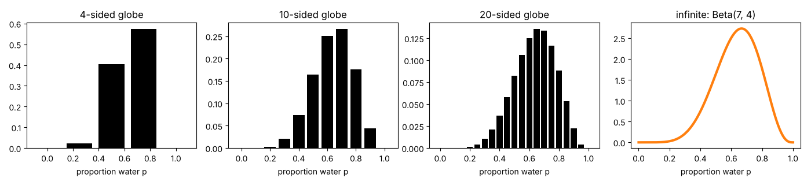
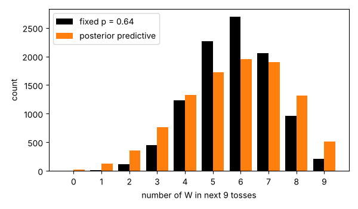

# Lecture 02 · The Garden of Forking Data 预习讲义

> 视频：<https://www.youtube.com/watch?v=R1vcdhPBlXA>（约 1 小时 15 分钟）
> 教材：*Statistical Rethinking* 第 2 版，**第 2 章**（重点）+ **第 3 章**（从后验抽样）
> Python 实现：`Lecture 02 - The Garden of Forking Data.ipynb`
> 对应作业：[homework/week01.pdf](https://github.com/rmcelreath/stat_rethinking_2023/blob/main/homework/week01.pdf)（第 1–3 题看完本课都能做）
> 热身脚本：`prep/lecture02_warmup.py`

---

## 0. 先说一句定心丸

这是整门课**最重要**的一课：后面 18 讲做的事，全都是这一课的放大版。
好消息是，这一课的数学**只有小学水平**：数数、乘法、除法。老师自己说贝叶斯推断是 “very simple, very humble”。

整节课一句话：

> **能以更多种方式发生的事情，更可信。**
> （Things that can happen more ways are more plausible.）

---

## 1. 这节课要解决的问题

**地球表面有多少比例是水？**

做法：把一个地球仪抛到空中，接住时看右手食指按在水上（W）还是陆地上（L）。抛 9 次，得到：

```
W L W W W L W L W     → 6 个 W，3 个 L
```

问题：根据这 9 次结果，水的比例 p 大概是多少？有多不确定？

> 🌍 **生活例子**：你在一家新餐厅吃了 9 次，6 次觉得好吃。这家店“好吃的概率”是多少？
> 🤖 **AI 例子**：一个新模型在 9 条测试样本上答对 6 条，它的真实准确率是多少？我能有多确定？
> 这三个问题**是同一个数学模型**。学会地球仪，你就学会了它们。

---

## 2. 核心概念（按视频顺序）

### 2.1 画猫头鹰的工作流（第一次出现）
1. 写出**生成模型**（数据是怎么产生的）
2. 明确**估计目标**（estimand）：这里是 p
3. 设计**统计方法**（估计器，estimator）
4. 用生成模型造假数据，**验证**估计器能找回 p
5. 用在真实数据上

> 第 3 讲会把这五步原样用到线性回归上。现在先熟悉它。

### 2.2 分岔花园：真的去数路径

把地球仪简化成**只有 4 个面**，每个面要么是水，要么是陆地。于是只有 5 种可能的猜想：水面有 0、1、2、3、4 个。

对每种猜想，数一数“能产生观察到的序列”的路径有几条。例如猜想“1 个水面、3 个陆地面”，观察到 W L W：
- 第 1 次是 W：4 个面里只有 1 个是水 → 1 种
- 第 2 次是 L：3 个陆地面 → 3 种
- 第 3 次是 W：1 种
- 一共 1 × 3 × 1 = **3 条路径**

脚本第 1 部分把 64 条路径全部枚举出来数了一遍，结果和乘法捷径完全一致：

| 猜想（水面数） | 0 | 1 | 2 | 3 | 4 |
|---|---|---|---|---|---|
| W L W 的路径数 | 0 | 3 | 8 | 9 | 0 |

**路径越多 → 这个猜想越可信。**

> 📐 **数学补课：乘法原理**。先选上衣（3 件），再选裤子（2 条），一共 3 × 2 = 6 种搭配。连续几步、每步独立，总方式数 = 各步方式数相乘。分岔花园就是这个。

<details><summary>✋ 检验一下：为什么“0 个水面”的路径数是 0？</summary>

因为我们至少看到了一个 W。全是陆地的地球仪不可能摸出水，所以 0 条路径，这个猜想被彻底排除。“4 个水面”同理，被 L 排除。
</details>

### 2.3 贝叶斯更新：新数据来了，就把计数再乘一次

数据一个一个到来时，**旧的计数 × 新数据的计数 = 新的计数**。脚本第 2 部分的输出：

```
第1次 W: [0 1 2 3 4]
第2次 L: [0 3 4 3 0]
...
第9次 W: [0  27  512  729  0]
```

两个重要性质：
- **今天的后验就是明天的先验**。不需要每次从头算。
- **顺序无所谓**。打乱数据顺序，结果完全一样（脚本里验证过）。

> 🤖 **AI 例子**：这就是“在线学习”（online learning）。每来一批新的用户反馈就更新一次估计，不用存下全部历史数据。

### 2.4 从计数到概率：除以总数

计数会变得非常大（几千、几百万），不方便比较。所以把每个计数**除以总和**，让它们加起来等于 1。这就是**概率**：

| 猜想 p | 0 | 0.25 | 0.5 | 0.75 | 1 |
|---|---|---|---|---|---|
| 计数 | 0 | 27 | 512 | 729 | 0 |
| 概率 | 0 | 0.021 | 0.404 | 0.575 | 0 |

> 📐 **数学补课：概率就是“归一化的计数”**。全班 40 人，12 人戴眼镜 → 12/40 = 0.3。没有比这更深的东西。

这里出现了三个名词，以后天天见：

| 名词 | 英文 | 白话 | 在地球仪里 |
|---|---|---|---|
| 先验 | prior | 看数据之前，每个猜想的初始计数 | 一开始全是 1（一视同仁） |
| 似然 | likelihood | 某个猜想能产生这批数据的路径数 | p^W × (1−p)^L |
| 后验 | posterior | 先验 × 似然，再归一化 | 上表最后一行 |

**后验 ∝ 先验 × 似然**（∝ 读作“正比于”，意思是还差一步“除以总数”）。

### 2.5 从 4 个面到无穷多个面：Beta 分布

4 面的地球仪太粗糙。改成 10 面、20 面……柱子越来越多、越来越细，最后变成一条平滑曲线：



这条曲线有名字，叫 **Beta 分布**。观察到 W 个水、L 个陆地，用均匀先验时，后验就是：

$$
p \sim \text{Beta}(W+1,\; L+1) \qquad \text{本例：Beta}(7, 4)
$$

> 📐 **数学补课：概率密度（density）**。柱子越多，每根越矮（因为加起来要等于 1），无穷多根时每根都是 0。所以连续情况下看的是曲线的**高度对比**（哪里更可能），概率等于曲线下的**面积**。你不需要会积分：下一节用抽样就能绕开它。

> 📐 **记号补课**：`p ~ Beta(7, 4)` 读作“p 服从 Beta(7, 4) 分布”。`~` 就是“从这个分布里来”。

**课上会强调的几点（视频后半段）：**
- **没有最小样本量**：只有 1 个数据也能算后验，只是很宽。
- **后验的形状本身就包含了样本量信息**：数据越多，曲线越窄。
- **没有“点估计”**：估计结果就是**整条曲线**，不是一个数。
- **区间没有唯一正确的画法**：画区间只是为了总结、沟通。

### 2.6 先测试，再估计（Test before you est-imate 🐤）

> “IF YOU TEST NOTHING, YOU MISS EVERYTHING.”

用已知的 p = 0.7 造假数据，看估计器能不能找回来。脚本第 4 部分的结果：

| 样本量 N | 后验均值 | 89% 区间 |
|---|---|---|
| 5 | 0.571 | [0.279, 0.841] |
| 20 | 0.591 | [0.422, 0.751] |
| 100 | 0.696 | [0.622, 0.767] |
| 1000 | 0.712 | [0.688, 0.734] |

数据越多，区间越窄，并且始终罩住真值 0.7。

> 🤖 **AI 例子**：这和“先在合成数据上验证你的评估流程”是一回事。比如写好一个指标计算脚本后，先喂一组你知道答案的数据，确认脚本没算错，再拿去评估真实模型。

### 2.7 把积分问题变成数数问题：从后验抽样

想知道“p 大于 0.5 的概率”，严格来说要算曲线下的面积（积分）。老师的办法是：

1. 从后验里**随机抽 10000 个 p**
2. **数一数**有多少个大于 0.5

```python
samples = stats.beta(7, 4).rvs(10_000)
np.mean(samples > 0.5)   # ≈ 0.83
```

> “TURN A CALCULUS PROBLEM INTO A DATA SUMMARY PROBLEM.”

对数学薄弱的人来说，这是整门课**最友好的一招**：以后所有复杂的计算（预测、因果效应、反事实）都靠抽样 + 求平均 / 数数完成。

<details><summary>✋ 检验一下：用样本怎么算 89% 区间？</summary>

`np.percentile(samples, [5.5, 94.5])`。把样本从小到大排好，砍掉两头各 5.5%，剩下中间 89% 的范围就是区间。（89 没有特殊含义，老师故意不用 95，提醒你别把它当显著性阈值。）
</details>

### 2.8 后验预测：再抛 9 次，会看到几个水？

做法分三步：
1. 从后验抽一个 p
2. 用这个 p 模拟抛 9 次，记下 W 的个数
3. 重复一万次，得到预测分布



黑色是“假装 p 已知等于 0.64”时的预测，橙色是后验预测。**后验预测更宽**（标准差 1.86 vs 1.44），因为它把“我们对 p 本身也不确定”这件事也算进去了。

> 🤖 **AI 例子**：只用一个点估计做预测，会让你**过度自信**。这就是模型不确定性校准（calibration）关心的问题：预测区间要同时包含“数据本身的随机性”和“模型参数的不确定性”。

### 2.9 （Bonus）测量误差 / 误分类

如果记录员有 10% 的概率记错，看到的 W* 就不是真实的 W。DAG 变成 `p → W → W* ← M`。把误差率写进似然，就能得到修正后的后验，它比忽略误差的后验更宽、也更“诚实”。

> 🤖 **AI 例子**：这就是**标签噪声**（label noise）。训练数据的标注员有一定错误率时，直接相信标签会让你对模型效果的估计有偏。第 17 讲会正式展开。

---

## 3. 用到工作中：A/B 测试就是地球仪

把“水 / 陆地”换成“点击 / 没点击”，“水的比例 p”换成“转化率”，就是一个**贝叶斯 A/B 测试**。脚本第 7 部分：

- 按钮 A：展示 200 次，点击 18 次
- 按钮 B：展示 180 次，点击 25 次

```
A 转化率 ≈ 0.094，B 转化率 ≈ 0.143
P(B 比 A 好) = 0.931
B-A 提升的 89% 区间 = [-0.004, 0.102]
```

做法只有三步：各自算 Beta 后验 → 各抽一万个样本 → 相减、数数。比 p 值容易解释得多：“B 更好的概率是 93%，提升幅度大约在 0 到 10 个百分点之间。”

同样的方法可以直接用于：比较两个 prompt 的成功率、两个模型的准确率、两版推荐策略的点击率。

---

## 4. Python Notebook 导读（按 cell 对照）

| Cell | 内容 | 对应讲义 | 看点 |
|---|---|---|---|
| 2–5 | 工作流、DAG | 2.1 | `utils.draw_causal_graph`（需要安装 graphviz） |
| 6–9 | 数路径、在线更新 | 2.2–2.3 | `calculate_n_ways_possible` |
| 10–16 | 整批数据、解析式、归一化成概率 | 2.4 | 计数公式 (R·p)^W × (R−R·p)^L |
| 17–26 | 生成模拟 + 验证估计器 | 2.6 | `simulate_globe_toss` |
| 27–31 | 从有限个面到 Beta 分布 | 2.5 | 9 个子图展示逐个更新 |
| 32–35 | 后验抽样 | 2.7 | `stats.beta(a, b).rvs(...)` |
| 36–38 | 后验预测 | 2.8 | 每个 p 样本模拟一次 |
| 40–46 | Bonus：误分类 | 2.9 | 选读 |

---

## 5. ⚠️ 老师提醒：Notebook 里的两个小坑

**坑 1：后验参数差了 1（cell 35、37）**
数据是 6W 3L，均匀先验下后验应该是 **Beta(7, 4)**（原版 R 脚本 [`02_predictive_simulation.r`](https://github.com/rmcelreath/stat_rethinking_2023/blob/main/scripts/02_predictive_simulation.r) 里写的就是 `a <- 1 + W`）。
Notebook 写的是 `a, b = 6, 3`，即 `stats.beta(6, 3)`，相当于只看到了 5W 2L。图形看起来差不多，但后面的后验预测因此略微偏窄。记住口诀：**Beta(W+1, L+1)**。

**坑 2：误分类的模拟和估计器不一致（cell 43、45）**
- 模拟函数只会把 W **错记成** L（单向错误）；
- 估计器却假设 W→L 和 L→W **两个方向**都会以 10% 的概率出错。

两者用的不是同一个生成模型，所以拿这个模拟去“验证”这个估计器是不成立的。这恰好是 2.6 节那句话的反面教材：**估计器要用和它假设一致的生成模型去测试**。选读即可，第 17 讲会重新讲。

**环境提醒**：notebook 基于 PyMC 5.8。本讲其实只用 numpy/scipy，基本不受版本影响；DAG 图需要额外安装 graphviz（`pip install graphviz`，并在系统里装 graphviz）。

---

## 6. 看视频前：动手热身（约 20 分钟）

```bash
cd statistical-rethinking-2023_python
pip install numpy scipy matplotlib pymc
python prep/lecture02_warmup.py
```

| 部分 | 内容 | 小练习（TODO） |
|---|---|---|
| 1 | 枚举 64 条路径，数一数 | 加一个观测，路径数怎么变？ |
| 2 | 逐个更新，打乱顺序 | 为什么 0 和 4 被排除？ |
| 3 | 4 面 → 无穷面 → Beta | 为什么柱子越多越矮？ |
| 4 | 用已知 p 验证估计器 | 极端值 p=0 或 1 还正常吗？ |
| 5 | 后验抽样做总结 | 算 P(0.6 < p < 0.8) |
| 6 | 后验预测 vs 固定 p | 为什么后验预测更宽？ |
| 7 | A/B 测试 | 小样本时结论怎么变？ |
| 8 | PyMC 写同一个模型（可选） | 和解析解对比 |

第 8 部分是你第一次接触 PyMC，只有 3 行：

```python
with pm.Model():
    p = pm.Uniform("p", 0, 1)                        # 先验
    pm.Binomial("W", n=9, p=p, observed=6)           # 似然
    idata = pm.sample()                              # 让电脑帮你抽后验样本
```

我实际跑出来：PyMC 后验均值 0.641、标准差 0.137；解析解 Beta(7, 4) 是 0.636、0.139，基本一致（MCMC 抽样有随机误差）。

---

## 7. 边看视频边回答的问题清单

1. 老师说贝叶斯数据分析“very simple, very humble”，简单在哪里？谦逊在哪里？
2. 抛地球仪时，生成模型里有哪几个变量？谁影响谁？
3. “数路径”和“乘法”是什么关系？
4. 为什么说贝叶斯更新是“今天的后验是明天的先验”？
5. 4 面地球仪的结果和无穷面地球仪的结果有什么联系？
6. 老师说“没有最小样本量”，那样本少有什么代价？
7. 为什么估计结果是“整个分布”而不是一个数？
8. “把微积分问题变成数据总结问题”具体指什么？
9. 后验预测比“固定参数的预测”宽，多出来的那部分宽度来自哪里？
10. 测量误差改变了 DAG 的哪一部分？

---

## 8. 看完后：自测题（答案折叠）

<details><summary>Q1. 如果先验不是“全是 1”，而是你事先就相信水多于陆地（比如给 p=0.75 的猜想先验计数 3，其他都是 1），后验会怎么变？</summary>

后验 = 先验 × 似然，所以 p=0.75 那一项的计数变成 729 × 3 = 2187，其他不变，归一化后 p=0.75 的概率从 0.575 升到约 0.80。先验就是“看数据之前的计数”。
</details>

<details><summary>Q2. 看到 W W W（3 次全是水），后验会认为 p = 1 吗？</summary>

不会。p=1 只是最可信的单个值，但 p=0.8、0.9 也很可信，后验是 Beta(4, 1)，一条从左往右上升的斜线。只有 3 个数据，所以不确定性很大。这正是“没有最小样本量，但样本少时后验宽”。
</details>

<details><summary>Q3. 用一句话向不懂统计的同事解释“后验分布”。</summary>

“在看了数据之后，对每一个可能的答案，我们各有多大把握。”
</details>

<details><summary>Q4. A/B 测试里，B 只展示了 18 次、点击 3 次（转化率 16.7%），能说 B 比 A（9%）好吗？</summary>

我实际跑了一下：P(B 比 A 好) ≈ 0.90，和大样本时的 0.93 差不多；但提升幅度的 89% 区间变成了约 [−0.02, 0.26]，比大样本时的 [−0.004, 0.10] 宽得多。

教训：**只看“B 更好的概率”会被误导**，还要看提升幅度的区间。样本少时，B 可能好很多，也可能根本没好，后验老老实实地把这种不确定性写在了区间宽度里。跑一下脚本第 7 部分的 TODO 自己验证。
</details>

---

## 9. 衔接作业 Week 01

作业在 [homework/week01.pdf](https://github.com/rmcelreath/stat_rethinking_2023/blob/main/homework/week01.pdf)，答案在 [week01_solutions.pdf](https://github.com/rmcelreath/stat_rethinking_2023/blob/main/homework/week01_solutions.pdf)。先自己做，卡住了再看下面的提示：

- **第 1 题**：数据变成 4W 11L，构造后验。
  <details><summary>提示</summary>用网格（脚本第 3 部分的 `grid_posterior(4, 11, 1001)`），或者直接写出 Beta(W+1, L+1)。</details>
- **第 2 题**：对接下来的 5 次抛掷做后验预测。
  <details><summary>提示</summary>照抄脚本第 6 部分，把后验换成第 1 题的，把 `n=9` 改成 `n=5`。</details>
- **第 3 题**：接下来 5 次里至少 3 次是水的概率。
  <details><summary>提示</summary>拿第 2 题的预测样本 `pred`，算 `np.mean(pred >= 3)`。又是“数一数”。</details>
- **第 4 题（选做）**：只知道看到了 5 个 W，忘了抛了几次，已知 p=0.7，求抛掷次数 N 的后验。
  <details><summary>提示</summary>对每个候选 N（5, 6, 7, ...），似然是 `stats.binom(N, 0.7).pmf(5)`。还是“对每个猜想，算它产生数据的可能性，然后归一化”。</details>

另外，老师建议复习第 1–3 章章末的 EASY 练习题。

---

## 10. 术语中英对照

| English | 中文 | 一句话 |
|---|---|---|
| garden of forking data | 分岔花园 | 把所有可能的数据路径画成树，然后数 |
| generative model | 生成模型 | 能造出假数据的模型 |
| estimand | 估计目标 | 你真正想知道的量（这里是 p） |
| estimator | 估计器 | 从数据算出答案的方法 |
| prior | 先验 | 看数据之前的计数 / 信念 |
| likelihood | 似然 | 某个猜想产生这批数据的方式数 |
| posterior | 后验 | 先验 × 似然，再归一化 |
| Bayesian updating | 贝叶斯更新 | 新数据来了就再乘一次 |
| probability density | 概率密度 | 连续情况下曲线的高度 |
| Beta distribution | Beta 分布 | 比例的后验分布，Beta(W+1, L+1) |
| binomial distribution | 二项分布 | 抛 N 次有几次成功 |
| posterior predictive | 后验预测 | 带着参数不确定性去预测新数据 |
| misclassification | 误分类 | 测量/标注出错 |
| compatibility interval | 相容区间 | 老师对“可信区间”的叫法 |
