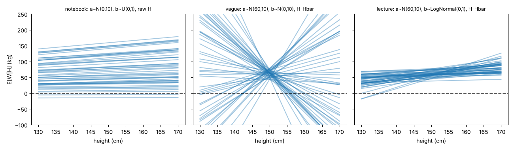

# Lecture 03 · Geocentric Models 预习讲义

> 视频：<https://youtu.be/tNOu-SEacNU>（约 1 小时）
> 教材：*Statistical Rethinking* 第 2 版，**第 4 章 4.1–4.4**（4.5 多项式/样条属于第 4 课）
> Python 实现：`Lecture 03 - Geocentric Models.ipynb`（PyMC）
> 对应作业：`stat_rethinking_2023_origin-/homework/week02.pdf`（第 1、2 题看完本课就能做，第 3 题要等第 4 课）
> 热身脚本：`prep/lecture03_warmup.py`

---

## 0. 这节课在整门课里的位置

| 课次 | 解决的问题 | 工具 |
|---|---|---|
| L01 | 为什么先有科学模型（DAG），再有统计 | 因果图 |
| L02 | 贝叶斯更新到底在算什么（地球仪抛掷） | 计数 → 后验，网格近似，后验抽样 |
| **L03** | **把 L02 的流程推广到连续变量：一个结果变量 + 一个预测变量** | **正态分布、线性回归、先验预测模拟、后验预测** |
| L04 | 加入类别变量（性别）和曲线关系 | 索引变量、多项式、样条 |

一句话概括：**L03 = 用 L02 的贝叶斯机器，跑一个线性回归，并且全程遵循“画猫头鹰”的工作流。**

---

## 1. 预习前自查（L02 的地基）

看视频前，确认下面几条你能不看书说出来；说不出来就先回去翻 `Lecture 02 - The Garden of Forking Data.ipynb`：

- [ ] 后验 ∝ 似然 × 先验，分母只是归一化常数
- [ ] 网格近似是怎么做的？它为什么在参数多了以后不可行？
- [ ] 为什么要从后验里**抽样**，再用样本做总结（区间、预测），而不是直接对公式积分？
- [ ] 后验预测分布 = 把参数的不确定性也传递到预测里

---

## 2. 核心概念地图

### 2.1 “地心说”比喻（标题的意思）
托勒密的地心模型在机理上是错的，但用本轮（epicycles）叠加，预测行星位置**非常准**。线性回归也一样：
- 它几乎从来不是真实的机理模型；
- 但它是一个非常好用的**描述/近似工具**，可以当作因果分析里的一个“齿轮”；
- 危险在于把它当作机理去解读。

> 带着问题看：老师说线性回归“geocentric”，褒义还是贬义？（答案：两者都有。）

### 2.2 为什么用正态分布？两个论证
1. **生成论证**：很多小的、独立的波动**相加**，结果趋向正态（足球场上抛硬币左右走的例子；乘法的小波动也近似，取对数后更明显）。
2. **推断论证**：如果你只愿意假设“有均值、有方差”，那么正态是**信息量最少（最大熵）**的分布——它是在这一约束下最保守的选择。

> 💡 重要误区纠正：变量本身**不需要**服从正态，用高斯误差模型也能估计出正确的均值和方差。

### 2.3 画猫头鹰（Drawing the Owl）五步工作流 ← 本课最核心
1. **问题 / 估计目标（estimand）**：成年人身高和体重的关系
2. **科学模型（DAG）**：`H → W ← U`（U 是未观测的其他原因）
3. **生成模型**：能用代码造出假数据
4. **统计模型（估计器）**：并**用生成模型造的数据测试它**能否找回真参数
5. **分析真实数据**

> 老师的态度：没测过的估计器不能用在真实数据上。这一步在 L03 里第一次完整演示。

### 2.4 模型记号（会一直用到最后一课）

$$
\begin{aligned}
W_i &\sim \text{Normal}(\mu_i, \sigma) && \text{似然：每个人的体重} \\
\mu_i &= \alpha + \beta (H_i - \bar H) && \text{线性模型：确定性关系，用“=”} \\
\alpha &\sim \text{Normal}(60, 10) && \text{先验} \\
\beta &\sim \text{LogNormal}(0, 1) && \text{先验：保证斜率为正} \\
\sigma &\sim \text{Uniform}(0, 10) && \text{先验}
\end{aligned}
$$

- `~`：随机关系（“服从某分布”）；`=`：确定性关系
- 下标 *i*：第 *i* 个观测
- 写代码时顺序通常是**反过来**的（先定义先验，再算 μ，最后写似然）

### 2.5 先验与先验预测模拟（prior predictive simulation）
- 先验应当编码**科学常识，但要“软”**：体重为正、身高越高平均越重、体重（kg）不会比身高（cm）还大……
- **怎么知道先验合不合理？把它画出来**：从先验抽 (α, β)，画出对应的直线。
- 没有“正确”的先验，只有能被科学论证的先验；模型越复杂，先验越重要。
- **中心化** `H - H̄` 的好处：α 变成“平均身高的人的平均体重”，非常好设先验；不中心化时 α 是“身高 0 cm 时的体重”，没有意义。

### 2.6 后验：参数不能孤立解读（Obey the Law）
- 后验是 (α, β, σ) 的**联合分布**，参数之间**相关**（不中心化时 α、β 强负相关）。
- 所以不要盯着 `summary` 表里的单个数字讲故事，要**把后验推成预测**：画后验直线束 + μ 的区间 + 体重的预测区间。

### 2.7 quap vs MCMC
- 书和课的前半段用 `quap`（二次近似 = 把后验近似成多元正态）。
- Python 仓库**统一用 PyMC 的 MCMC**（`pm.sample`），对这种小模型同样很快，结论一致。MCMC 原理第 8 课才讲，现在当黑箱用即可。

---

## 3. Python Notebook 导读（按 cell 对照）

| Cell | 内容 | 对应课堂部分 | 看点 |
|---|---|---|---|
| 2–3 | 随机游走生成正态 | Why Normal | 用 `stats.bernoulli` 模拟左右走 |
| 4–5 | 载入 `Howell1`，筛成年人 | Owl 第 1 步 | `utils.load_data`，`age >= 18` |
| 6–8 | DAG `H→W←U` | Owl 第 2 步 | `utils.draw_causal_graph`（需要 graphviz） |
| 9–10 | `simulate_weight` 生成模型 | Owl 第 3 步 | 先能造数据 |
| 11–18 | 后验公式 + 网格近似动画 | 贝叶斯更新 | `utils.simulate_2_parameter_bayesian_learning_grid_approximation` |
| 19 | 为什么用 MCMC 不用 quap | — | 读一下就行 |
| 20–21 | 先验预测模拟 | Owl 第 4 步 | **对照下文第 4 节的差异** |
| 22–25 | 用模拟数据、不同样本量验证估计器 | Owl 第 4 步 | 样本量 1→200 后验如何收缩 |
| 26–28 | 拟合真实成年人数据 | Owl 第 5 步 | `az.summary` |
| 29–30 | 参数配对图（pairplot） | Obey the Law | 看 α、β 的相关性 |
| 31–32 | 后验直线 + 预测区间 | Obey the Law | `pm.sample_posterior_predictive` |

---

## 4. ⚠️ 老师提醒：Notebook 和课堂讲法的两处差异

**差异 1：先验设定与是否中心化**

| | Notebook | 课堂 / 原始 R 脚本 `03_howell_new_weight_model.r` |
|---|---|---|
| 线性模型 | `mu = alpha + beta * H` | `mu = a + b * (H - Hbar)` |
| α 先验 | Normal(0, 10) | Normal(60, 10) |
| β 先验 | Uniform(0, 1) | LogNormal(0, 1) |

两种都能得到合理的后验预测，但：notebook 版本的 α 是“身高 0 时的体重”，α 与 β 后验高度相关（pairplot 里一条斜线）；课堂版本 α、β 基本独立，先验也更好解释。热身脚本第 3 部分把三组先验画在一起，下图右边就是课堂版本：



**差异 2：PyMC 版本**
Notebook 基于 PyMC 5.8 写成。如果你装的是新版（我这里测试的是 PyMC 6.4）：
- `pm.MutableData(...)` 已弃用 → 改成 `pm.Data(...)`
- `pm.sample` 返回的结果在新版里是 xarray `DataTree`，`.stack(...)` 之类的旧写法可能报错；稳妥做法是 `idata.posterior["a"].values.reshape(-1)` 取样本
- 想完全复现 notebook，最省心的是用仓库自带的 `statistical-rethinking-2023.yml` 建 conda 环境

---

## 5. 看视频前：动手热身（约 20 分钟）

```bash
cd statistical-rethinking-2023_python
pip install numpy scipy pandas matplotlib pymc   # 或使用仓库的 conda 环境
python prep/lecture03_warmup.py
```

脚本分 5 部分，图存到 `prep/figs/`，每部分末尾有 `TODO` 小练习：

1. 随机游走 → 正态（试试 2/4/8 步，试试相乘）
2. 写生成模型造数据
3. 三组先验的先验预测线对比
4. 二维网格近似，看后验随样本量收缩（并体会再加一个 σ 参数网格会爆炸）
5. （需要 PyMC）先用模拟数据验证能找回真参数，再拟合 Howell 成年人数据，画后验预测

我实际跑出来的参考结果（你的数字会有随机波动）：

| | a | b | σ |
|---|---|---|---|
| 模拟数据（真值 70 / 0.5 / 5） | 70.09 ± 0.58 | 0.55 ± 0.05 | 5.62 ± 0.43 |
| Howell 成人，N=352，H̄=154.6 | 45.00 ± 0.22 | 0.63 ± 0.03 | 4.26 ± 0.17 |

解读示范：平均身高（154.6 cm）的成年人平均体重约 45 kg；身高每多 1 cm，平均体重多约 0.63 kg；个体围绕均值线的散布约 ±4.3 kg（1 个 σ）。

---

## 6. 边看边回答的问题清单

1. 托勒密模型和线性回归在什么意义上“相似”？
2. 正态分布的两个论证分别是什么？哪个论证说明“数据不必是正态的”？
3. 画猫头鹰五步各是什么？为什么第 4 步（用假数据测试）不能省？
4. `~` 和 `=` 在模型记号里分别表示什么？
5. 老师第一次画出的先验预测线有什么荒谬之处？他怎么改先验的？
6. 为什么 β 用 LogNormal？它的支撑集（取值范围）是多少？
7. 为什么要把身高减去均值？α 的含义变成了什么？
8. “参数不能孤立解读”具体指什么？老师建议用什么替代？
9. μ 的区间和 W 的预测区间有什么区别？哪个更宽，为什么？
10. 本课结尾留下了什么问题，引出第 4 课？（提示：性别、非线性）

---

## 7. 看完后：自测题（答案折叠）

<details><summary>Q1. σ ~ Uniform(0, 10) 和 σ ~ Exponential(1) 哪个是你在后续课程里会更常见到的？为什么？</summary>

后者更常见。均匀先验有一个硬上界，若真实 σ 接近上界会被截断；指数分布只要求为正、偏好较小值，更“软”。书中后续章节大量使用 Exponential(1) 作为尺度参数的先验。
</details>

<details><summary>Q2. 后验里 b 的均值是 0.63，能说“身高导致体重增加 0.63 kg/cm”吗？</summary>

在本课 DAG `H → W ← U` 且 U 与 H 独立的假设下，这是 H 对 W 的因果效应估计；但这个结论**来自 DAG 假设，不是来自回归本身**。若存在混杂（比如性别同时影响身高和体重），就需要第 4–6 课的工具。
</details>

<details><summary>Q3. 为什么 89% 而不是 95% 区间？</summary>

没有任何特殊意义——老师故意选一个“不像惯例”的数，提醒大家区间宽度只是总结方式，不是显著性检验阈值。
</details>

<details><summary>Q4. 不中心化时，α 和 β 的后验为什么强负相关？</summary>

所有合理的直线都必须经过数据云中心 (H̄, W̄)。斜率 β 变大时，为了仍过这个点，截距（H=0 处）必须变小，于是两者负相关。中心化后截距就定在数据中心，相关性消失。
</details>

---

## 8. 衔接作业 Week 02

- **第 1 题**（<13 岁儿童，年龄 → 身高 → 体重，以及年龄 → 体重）：完全是本课的“画猫头鹰”第 2–3 步：画 DAG + 写生成模拟函数。
- **第 2 题**（年龄对体重的**总**因果效应）：本课的线性回归即可；想一想为什么**不**应该把身高放进模型（提示：它在因果路径上，第 5–6 课会正式讲）。
- **第 3 题**（分性别）：需要第 4 课的索引变量和后验对比（contrast），先别急。
- 做完后对照 `homework/week02_solutions.pdf`（R 代码，可以按本讲义第 4 节的方式翻译成 PyMC）。

---

## 9. 术语中英对照

| English | 中文 |
|---|---|
| estimand / estimator / estimate | 估计目标 / 估计器 / 估计值 |
| generative model | 生成模型 |
| prior predictive simulation | 先验预测模拟 |
| posterior predictive distribution | 后验预测分布 |
| quadratic approximation (quap) | 二次近似 |
| maximum entropy | 最大熵 |
| centering / standardizing | 中心化 / 标准化 |
| compatibility interval | 相容区间（老师用来替代“置信区间”的说法） |
| contrast | 对比（两组后验之差的分布） |
